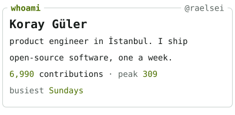
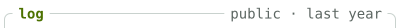

<!-- afterglow:start -->

<a href="https://koray.dev"><picture><source media="(prefers-color-scheme: dark)" srcset="https://raw.githubusercontent.com/raelsei/raelsei/output/year-compact-2c6de0f3-dark.svg"></picture></a><a href="https://koray.dev"><picture><source media="(prefers-color-scheme: dark)" srcset="https://raw.githubusercontent.com/raelsei/raelsei/output/whoami-compact-c13b21f5-dark.svg"></picture></a> 
<a href="https://github.com/search?q=author%3Araelsei&#38;type=commits&#38;s=author-date&#38;o=desc"><picture><source media="(prefers-color-scheme: dark)" srcset="https://raw.githubusercontent.com/raelsei/raelsei/output/log-head-dd3f0160-dark.svg"></picture></a> 
<a href="https://github.com/koative/openmacapps/commit/aa2c5476c2db2028c24cfdbc20539157f101e009"><picture><source media="(prefers-color-scheme: dark)" srcset="https://raw.githubusercontent.com/raelsei/raelsei/output/log-commit-ba2269d2-dark.svg"></picture></a> 
<a href="https://github.com/koative/openmacapps/commit/e5bf22fea904a7f358c7b5ffcd079bb0bd8475f6"><picture><source media="(prefers-color-scheme: dark)" srcset="https://raw.githubusercontent.com/raelsei/raelsei/output/log-commit-d560ef83-dark.svg"></picture></a> 
<a href="https://github.com/koative/openmacapps/commit/82627bdf4251d0bc5baa3dac72644712d1ecddcc"><picture><source media="(prefers-color-scheme: dark)" srcset="https://raw.githubusercontent.com/raelsei/raelsei/output/log-commit-2b624712-dark.svg"></picture></a> 
<a href="https://github.com/koative/openmacapps/commit/af76145e1bbba93148d5759045960d2dcba44698"><picture><source media="(prefers-color-scheme: dark)" srcset="https://raw.githubusercontent.com/raelsei/raelsei/output/log-commit-b6c7f36f-dark.svg"></picture></a> 
<picture><source media="(prefers-color-scheme: dark)" srcset="https://raw.githubusercontent.com/raelsei/raelsei/output/log-foot-127bddb5-dark.svg"></picture> 
<a href="https://koray.dev"><picture><source media="(prefers-color-scheme: dark)" srcset="https://raw.githubusercontent.com/raelsei/raelsei/output/bar-session-7df00a59-dark.svg"></picture></a><a href="https://koray.dev"><picture><source media="(prefers-color-scheme: dark)" srcset="https://raw.githubusercontent.com/raelsei/raelsei/output/bar-link-37fbbb2f-dark.svg"></picture></a><a href="https://x.com/raelsei"><picture><source media="(prefers-color-scheme: dark)" srcset="https://raw.githubusercontent.com/raelsei/raelsei/output/bar-link-dbe47e93-dark.svg"></picture></a><a href="https://linkedin.com/in/raelsei"><picture><source media="(prefers-color-scheme: dark)" srcset="https://raw.githubusercontent.com/raelsei/raelsei/output/bar-link-0ce9ec82-dark.svg"></picture></a><a href="https://t.me/raelsei"><picture><source media="(prefers-color-scheme: dark)" srcset="https://raw.githubusercontent.com/raelsei/raelsei/output/bar-link-97866d06-dark.svg"></picture></a><a href="mailto:hello@koray.dev"><picture><source media="(prefers-color-scheme: dark)" srcset="https://raw.githubusercontent.com/raelsei/raelsei/output/bar-link-0e69fbec-dark.svg"></picture></a><a href="https://github.com/raelsei/afterglow"><picture><source media="(prefers-color-scheme: dark)" srcset="https://raw.githubusercontent.com/raelsei/raelsei/output/bar-clock-5685a996-dark.svg"></picture></a> 

<!-- afterglow:end -->
