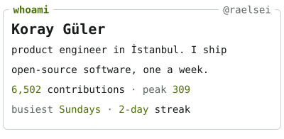
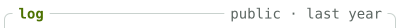
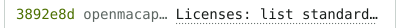
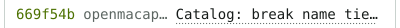
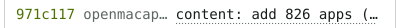
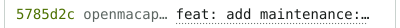
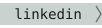
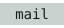

<!-- afterglow:start -->

<a href="https://koray.dev"><picture><source media="(prefers-color-scheme: dark)" srcset="https://raw.githubusercontent.com/raelsei/raelsei/output/year-compact-22044cce-dark.svg"></picture></a><a href="https://koray.dev"><picture><source media="(prefers-color-scheme: dark)" srcset="https://raw.githubusercontent.com/raelsei/raelsei/output/whoami-compact-1553089a-dark.svg"></picture></a> 
<a href="https://github.com/search?q=author%3Araelsei&#38;type=commits&#38;s=author-date&#38;o=desc"><picture><source media="(prefers-color-scheme: dark)" srcset="https://raw.githubusercontent.com/raelsei/raelsei/output/log-head-dd3f0160-dark.svg"></picture></a> 
<a href="https://github.com/koative/openmacapps/commit/3892e8da878c9fa2114765e0f277ede4962d029a"><picture><source media="(prefers-color-scheme: dark)" srcset="https://raw.githubusercontent.com/raelsei/raelsei/output/log-commit-66548821-dark.svg"></picture></a> 
<a href="https://github.com/koative/openmacapps/commit/669f54b0be4238c810898fc062d48a69551155ef"><picture><source media="(prefers-color-scheme: dark)" srcset="https://raw.githubusercontent.com/raelsei/raelsei/output/log-commit-83eb753e-dark.svg"></picture></a> 
<a href="https://github.com/koative/openmacapps/commit/971c1175f758af6179c744a0c35b702c529dbb33"><picture><source media="(prefers-color-scheme: dark)" srcset="https://raw.githubusercontent.com/raelsei/raelsei/output/log-commit-5319f18a-dark.svg"></picture></a> 
<a href="https://github.com/koative/openmacapps/commit/5785d2cb0980cfd63360b96677c4aa07e59bbe2a"><picture><source media="(prefers-color-scheme: dark)" srcset="https://raw.githubusercontent.com/raelsei/raelsei/output/log-commit-21725acb-dark.svg"></picture></a> 
<picture><source media="(prefers-color-scheme: dark)" srcset="https://raw.githubusercontent.com/raelsei/raelsei/output/log-foot-127bddb5-dark.svg"></picture> 
<a href="https://koray.dev"><picture><source media="(prefers-color-scheme: dark)" srcset="https://raw.githubusercontent.com/raelsei/raelsei/output/bar-session-7df00a59-dark.svg"></picture></a><a href="https://koray.dev"><picture><source media="(prefers-color-scheme: dark)" srcset="https://raw.githubusercontent.com/raelsei/raelsei/output/bar-link-37fbbb2f-dark.svg"></picture></a><a href="https://x.com/raelsei"><picture><source media="(prefers-color-scheme: dark)" srcset="https://raw.githubusercontent.com/raelsei/raelsei/output/bar-link-dbe47e93-dark.svg"></picture></a><a href="https://linkedin.com/in/raelsei"><picture><source media="(prefers-color-scheme: dark)" srcset="https://raw.githubusercontent.com/raelsei/raelsei/output/bar-link-0ce9ec82-dark.svg"></picture></a><a href="https://t.me/raelsei"><picture><source media="(prefers-color-scheme: dark)" srcset="https://raw.githubusercontent.com/raelsei/raelsei/output/bar-link-97866d06-dark.svg"></picture></a><a href="mailto:hello@koray.dev"><picture><source media="(prefers-color-scheme: dark)" srcset="https://raw.githubusercontent.com/raelsei/raelsei/output/bar-link-0e69fbec-dark.svg"></picture></a><a href="https://github.com/raelsei/afterglow"><picture><source media="(prefers-color-scheme: dark)" srcset="https://raw.githubusercontent.com/raelsei/raelsei/output/bar-clock-a3b394e5-dark.svg"></picture></a> 

<!-- afterglow:end -->
