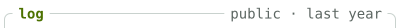

<!-- afterglow:start -->

<a href="https://koray.dev"><picture><source media="(prefers-color-scheme: dark)" srcset="https://raw.githubusercontent.com/raelsei/raelsei/output/year-compact-1472a4db-dark.svg"></picture></a><a href="https://koray.dev"><picture><source media="(prefers-color-scheme: dark)" srcset="https://raw.githubusercontent.com/raelsei/raelsei/output/whoami-compact-76403803-dark.svg"></picture></a> 
<a href="https://github.com/search?q=author%3Araelsei&#38;type=commits&#38;s=author-date&#38;o=desc"><picture><source media="(prefers-color-scheme: dark)" srcset="https://raw.githubusercontent.com/raelsei/raelsei/output/log-head-dd3f0160-dark.svg"></picture></a> 
<a href="https://github.com/raelsei/raelsei.github.io/commit/b16b31af0ee824d639fceb0ef10dd056a738a5ce"><picture><source media="(prefers-color-scheme: dark)" srcset="https://raw.githubusercontent.com/raelsei/raelsei/output/log-commit-4a112e06-dark.svg"></picture></a> 
<a href="https://github.com/raelsei/koray.dev/commit/3835aacde0c8c6f472b8a3677a62531982b442ac"><picture><source media="(prefers-color-scheme: dark)" srcset="https://raw.githubusercontent.com/raelsei/raelsei/output/log-commit-a100b544-dark.svg"></picture></a> 
<a href="https://github.com/raelsei/koray.dev/commit/4511f43d5e970bb74aa97cc428b894b52a5b8f7b"><picture><source media="(prefers-color-scheme: dark)" srcset="https://raw.githubusercontent.com/raelsei/raelsei/output/log-commit-fe600315-dark.svg"></picture></a> 
<a href="https://github.com/koative/openmacapps/commit/f8e852ce9bbe44674d5b195f9ba36281d79e43e0"><picture><source media="(prefers-color-scheme: dark)" srcset="https://raw.githubusercontent.com/raelsei/raelsei/output/log-commit-3ad93ce5-dark.svg"></picture></a> 
<picture><source media="(prefers-color-scheme: dark)" srcset="https://raw.githubusercontent.com/raelsei/raelsei/output/log-foot-127bddb5-dark.svg"></picture> 
<a href="https://koray.dev"><picture><source media="(prefers-color-scheme: dark)" srcset="https://raw.githubusercontent.com/raelsei/raelsei/output/bar-session-7df00a59-dark.svg"></picture></a><a href="https://koray.dev"><picture><source media="(prefers-color-scheme: dark)" srcset="https://raw.githubusercontent.com/raelsei/raelsei/output/bar-link-37fbbb2f-dark.svg"></picture></a><a href="https://x.com/raelsei"><picture><source media="(prefers-color-scheme: dark)" srcset="https://raw.githubusercontent.com/raelsei/raelsei/output/bar-link-dbe47e93-dark.svg"></picture></a><a href="https://linkedin.com/in/raelsei"><picture><source media="(prefers-color-scheme: dark)" srcset="https://raw.githubusercontent.com/raelsei/raelsei/output/bar-link-0ce9ec82-dark.svg"></picture></a><a href="https://t.me/raelsei"><picture><source media="(prefers-color-scheme: dark)" srcset="https://raw.githubusercontent.com/raelsei/raelsei/output/bar-link-97866d06-dark.svg"></picture></a><a href="mailto:hello@koray.dev"><picture><source media="(prefers-color-scheme: dark)" srcset="https://raw.githubusercontent.com/raelsei/raelsei/output/bar-link-0e69fbec-dark.svg"></picture></a><a href="https://github.com/raelsei/afterglow"><picture><source media="(prefers-color-scheme: dark)" srcset="https://raw.githubusercontent.com/raelsei/raelsei/output/bar-clock-861823d9-dark.svg"></picture></a> 

<!-- afterglow:end -->
