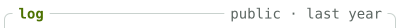

<!-- afterglow:start -->

<a href="https://koray.dev"><picture><source media="(prefers-color-scheme: dark)" srcset="https://raw.githubusercontent.com/raelsei/raelsei/output/year-compact-95f1ebe3-dark.svg"></picture></a><a href="https://koray.dev"><picture><source media="(prefers-color-scheme: dark)" srcset="https://raw.githubusercontent.com/raelsei/raelsei/output/whoami-compact-371d903b-dark.svg"></picture></a> 
<a href="https://github.com/search?q=author%3Araelsei&#38;type=commits&#38;s=author-date&#38;o=desc"><picture><source media="(prefers-color-scheme: dark)" srcset="https://raw.githubusercontent.com/raelsei/raelsei/output/log-head-dd3f0160-dark.svg"></picture></a> 
<a href="https://github.com/raelsei/raelsei/commit/cdeba5091780dc23462c73c1b82341a7574a3131"><picture><source media="(prefers-color-scheme: dark)" srcset="https://raw.githubusercontent.com/raelsei/raelsei/output/log-commit-7cc0e6ed-dark.svg"></picture></a> 
<a href="https://github.com/koative/bucketdeck/commit/161e34269bd69bd2391969286968385b9c9d6191"><picture><source media="(prefers-color-scheme: dark)" srcset="https://raw.githubusercontent.com/raelsei/raelsei/output/log-commit-59a96ff7-dark.svg"></picture></a> 
<a href="https://github.com/raelsei/raelsei/commit/f080e0e34d22485d9bbc1c8f0e63296c6ac96f73"><picture><source media="(prefers-color-scheme: dark)" srcset="https://raw.githubusercontent.com/raelsei/raelsei/output/log-commit-06f05e0e-dark.svg"></picture></a> 
<a href="https://github.com/koative/hyperliquid-go/commit/de8a910a1e8683fc8c5ba2a1ed2af15d43b77c5c"><picture><source media="(prefers-color-scheme: dark)" srcset="https://raw.githubusercontent.com/raelsei/raelsei/output/log-commit-ba4615e0-dark.svg"></picture></a> 
<picture><source media="(prefers-color-scheme: dark)" srcset="https://raw.githubusercontent.com/raelsei/raelsei/output/log-foot-127bddb5-dark.svg"></picture> 
<a href="https://koray.dev"><picture><source media="(prefers-color-scheme: dark)" srcset="https://raw.githubusercontent.com/raelsei/raelsei/output/bar-session-7df00a59-dark.svg"></picture></a><a href="https://koray.dev"><picture><source media="(prefers-color-scheme: dark)" srcset="https://raw.githubusercontent.com/raelsei/raelsei/output/bar-link-37fbbb2f-dark.svg"></picture></a><a href="https://x.com/raelsei"><picture><source media="(prefers-color-scheme: dark)" srcset="https://raw.githubusercontent.com/raelsei/raelsei/output/bar-link-dbe47e93-dark.svg"></picture></a><a href="https://linkedin.com/in/raelsei"><picture><source media="(prefers-color-scheme: dark)" srcset="https://raw.githubusercontent.com/raelsei/raelsei/output/bar-link-0ce9ec82-dark.svg"></picture></a><a href="https://t.me/raelsei"><picture><source media="(prefers-color-scheme: dark)" srcset="https://raw.githubusercontent.com/raelsei/raelsei/output/bar-link-97866d06-dark.svg"></picture></a><a href="mailto:hello@koray.dev"><picture><source media="(prefers-color-scheme: dark)" srcset="https://raw.githubusercontent.com/raelsei/raelsei/output/bar-link-0e69fbec-dark.svg"></picture></a><a href="https://github.com/raelsei/afterglow"><picture><source media="(prefers-color-scheme: dark)" srcset="https://raw.githubusercontent.com/raelsei/raelsei/output/bar-clock-71645d15-dark.svg"></picture></a> 

<!-- afterglow:end -->
