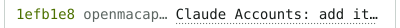
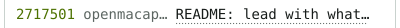

<!-- afterglow:start -->

<a href="https://koray.dev"><picture><source media="(prefers-color-scheme: dark)" srcset="https://raw.githubusercontent.com/raelsei/raelsei/output/year-compact-06ffc045-dark.svg"></picture></a><a href="https://koray.dev"><picture><source media="(prefers-color-scheme: dark)" srcset="https://raw.githubusercontent.com/raelsei/raelsei/output/whoami-compact-dad780e7-dark.svg"></picture></a> 
<a href="https://github.com/search?q=author%3Araelsei&#38;type=commits&#38;s=author-date&#38;o=desc"><picture><source media="(prefers-color-scheme: dark)" srcset="https://raw.githubusercontent.com/raelsei/raelsei/output/log-head-dd3f0160-dark.svg"></picture></a> 
<a href="https://github.com/koative/openmacapps/commit/1efb1e8bc3098c5ceef38786c8f03f8d8a45f4e2"><picture><source media="(prefers-color-scheme: dark)" srcset="https://raw.githubusercontent.com/raelsei/raelsei/output/log-commit-e5dfbceb-dark.svg"></picture></a> 
<a href="https://github.com/koative/openmacapps/commit/2717501089f53764f299fc3e7ecf95e57e1d8891"><picture><source media="(prefers-color-scheme: dark)" srcset="https://raw.githubusercontent.com/raelsei/raelsei/output/log-commit-3c5fcb3f-dark.svg"></picture></a> 
<a href="https://github.com/koative/openmacapps/commit/ce72ac72f4141f83510e67a98801569ba1a00365"><picture><source media="(prefers-color-scheme: dark)" srcset="https://raw.githubusercontent.com/raelsei/raelsei/output/log-commit-7451a5d5-dark.svg"></picture></a> 
<a href="https://github.com/koative/openmacapps/commit/d0f5a4b4f207952aafae5b6c5d3ba98d08aefe0e"><picture><source media="(prefers-color-scheme: dark)" srcset="https://raw.githubusercontent.com/raelsei/raelsei/output/log-commit-bf303e2d-dark.svg"></picture></a> 
<picture><source media="(prefers-color-scheme: dark)" srcset="https://raw.githubusercontent.com/raelsei/raelsei/output/log-foot-127bddb5-dark.svg"></picture> 
<a href="https://koray.dev"><picture><source media="(prefers-color-scheme: dark)" srcset="https://raw.githubusercontent.com/raelsei/raelsei/output/bar-session-7df00a59-dark.svg"></picture></a><a href="https://koray.dev"><picture><source media="(prefers-color-scheme: dark)" srcset="https://raw.githubusercontent.com/raelsei/raelsei/output/bar-link-37fbbb2f-dark.svg"></picture></a><a href="https://x.com/raelsei"><picture><source media="(prefers-color-scheme: dark)" srcset="https://raw.githubusercontent.com/raelsei/raelsei/output/bar-link-dbe47e93-dark.svg"></picture></a><a href="https://linkedin.com/in/raelsei"><picture><source media="(prefers-color-scheme: dark)" srcset="https://raw.githubusercontent.com/raelsei/raelsei/output/bar-link-0ce9ec82-dark.svg"></picture></a><a href="https://t.me/raelsei"><picture><source media="(prefers-color-scheme: dark)" srcset="https://raw.githubusercontent.com/raelsei/raelsei/output/bar-link-97866d06-dark.svg"></picture></a><a href="mailto:hello@koray.dev"><picture><source media="(prefers-color-scheme: dark)" srcset="https://raw.githubusercontent.com/raelsei/raelsei/output/bar-link-0e69fbec-dark.svg"></picture></a><a href="https://github.com/raelsei/afterglow"><picture><source media="(prefers-color-scheme: dark)" srcset="https://raw.githubusercontent.com/raelsei/raelsei/output/bar-clock-fc6ec496-dark.svg"></picture></a> 

<!-- afterglow:end -->
